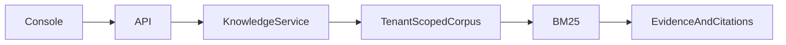

# Evidence Hub

> Conhecimento corporativo com evidências e isolamento

Uma busca corporativa precisa citar documentos e impedir que uma empresa consulte a base de outra.

Projeto de portfólio executável, com dados sintéticos. Não representa um sistema em produção nem resultados de clientes.

## O que está implementado

Ingestão com deduplicação por hash; chunking com sobreposição; busca BM25 normalizada para acentos; citações com documento e trecho; resposta extrativa; abstenção sem correspondência; exclusão em cascata e isolamento por tenant.

## Executar em cinco minutos

Requer Python 3.12 ou 3.13. Execute dentro desta pasta:

```powershell
python -m venv .venv
.venv\Scripts\Activate.ps1
python -m pip install -r requirements.txt
python -m uvicorn app.main:app --port 8102
```

Linux/macOS: ative com `source .venv/bin/activate`.
Abra http://localhost:8102 para a console e http://localhost:8102/docs para o contrato OpenAPI.
As chaves locais são `local-alpha` e `local-beta`, enviadas em `X-API-Key`.

### Demonstração

Indexe a política de reembolso pela console e consulte o prazo. Observe o trecho citado. Troque a chave para local-beta e repita a consulta: o sistema se abstém porque o segundo tenant não tem documentos.

### Testes

```bash
python -m pytest -q
```

Os testes usam bancos temporários. Verificam isolamento, autenticação, regras de domínio e cenários de falha.

### Docker

```bash
docker build -t evidence-hub .
docker run --rm -p 8102:8102 evidence-hub
```

O container usa usuário sem privilégios. O banco é efêmero nesse comando; monte um volume e configure DATABASE_PATH para persistência.

## Arquitetura



`app/main.py` define contratos HTTP; `app/service.py` contém casos de uso e transações;
o módulo de domínio contém o algoritmo; `app/platform.py` concentra autenticação e conexão.

Leia [decisões e tradeoffs](docs/architecture.md), [modelo e limites](docs/model-card.md),
[operação](docs/runbook.md) e [segurança](SECURITY.md).

## Limites conhecidos

É a camada de recuperação de uma arquitetura RAG, com resposta extrativa; não há LLM, embeddings ou busca semântica. Uma correspondência lexical não comprova relevância ou veracidade. O corpus é carregado em memória por consulta, sem paginação; apropriado para demonstração pequena. Excluir um documento não equivale a apagar backups ou mídias físicas.

## Próximos incrementos

Adicionar avaliação rotulada com recall@k e MRR; PostgreSQL com RLS; índice híbrido lexical/vetorial; autorização por documento; adaptador de geração opcional que preserve citações e use testes de fidelidade.

## Integração PHP

[Ponte de ingestão PHP](integrations/php/README.md) para integração com sistemas legados: validação, destinos restritos, timeout e envio autenticado à API.

## Verificação em navegador

O job `browser` da CI executa fluxos em Chromium, verifica a versão de 390 px e publica capturas como artifact `dashboard-screenshots`. Execute `npm install` em `ui/`, `npx playwright install chromium` e `node ui/smoke.cjs` na raiz com a API em localhost:8000 para repetir.
